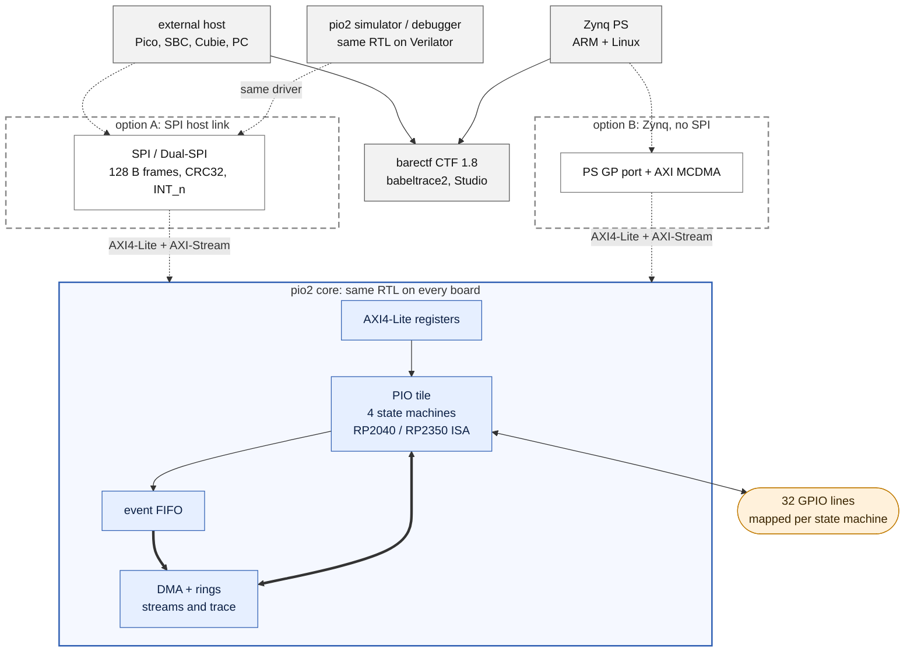
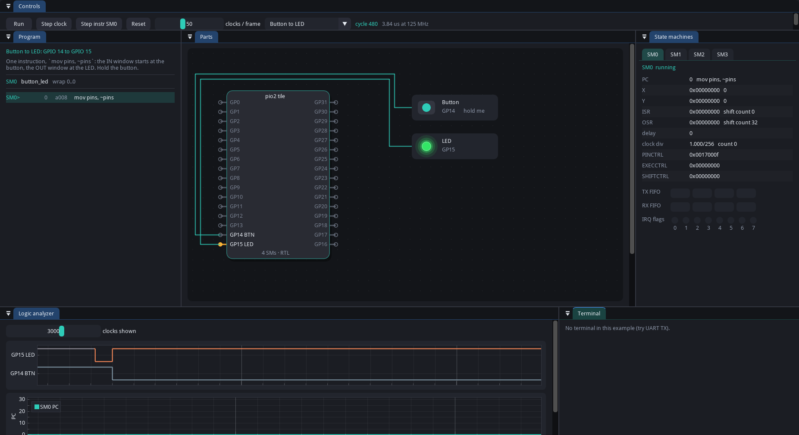
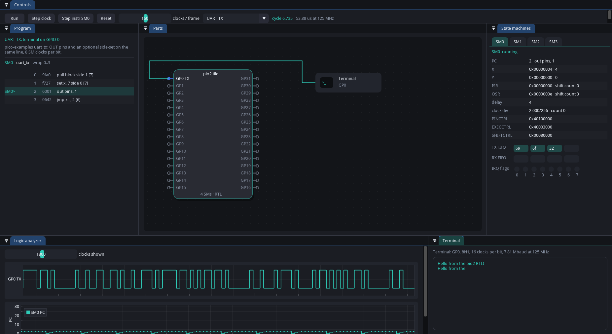
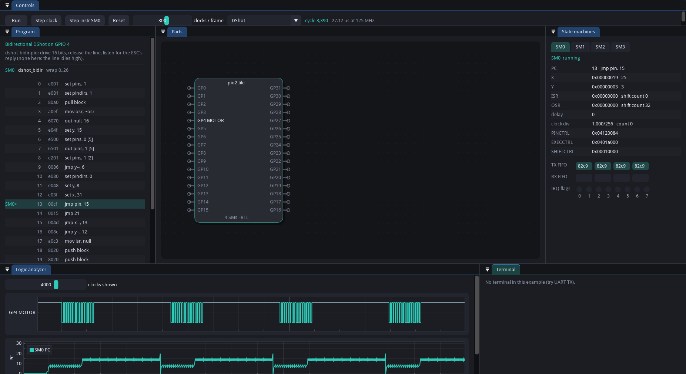
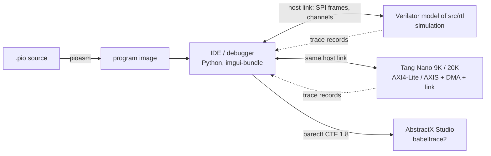

# pio2

A programmable I/O block that runs the Raspberry Pi RP2040 / RP2350 PIO instruction set,
written in SystemVerilog for FPGAs, plus the tools to write, test and **see** PIO programs run.

* `src/rtl/`: the PIO tile (four state machines, shared 32-word instruction memory, FIFOs, IRQs,
  pin mapping, side-set) with an AXI4-Lite register port, and the interconnect blocks around it
  (event FIFO so far; SPI link, DMA and crossbar to come). The TLP adapter inherited from AbstractX
  is still in the tile and moves out to AbstractX's wrapper next.
* `src/programs/`: the program library (`.pio` sources and the `pioasm` images next to them):
  bidirectional DShot600, ESC serial passthrough, the conformance suite, and programs from
  Raspberry Pi's pico-examples (BSD-3-Clause, see `src/programs/examples/pico/LICENSE.TXT`).
* `src/pio2/`: Python package: program loader / assembler wrapper, example importer, DShot
  reference decoder, and (in progress) the visual debugger.
* `tests/cocotb/`: cocotb regression of the tile on Verilator.
* `docs/`: specification (`[SPEC-PIO-*]` requirements), architecture, debugger design, links.

The design goal of the debugger is in [`docs/DEBUGGER_SPECIFICATION.md`](docs/DEBUGGER_SPECIFICATION.md): single-step the real
RTL (not a separate software model) one clock or one instruction at a time, with every state
machine's registers, FIFOs, clock divider phase, stall reason and pins visible.

This project started as `rtl/pio` inside [AbstractX](https://github.com/tcmichals/AbstractX), which
uses it as a git submodule ([`docs/provenance.md`](docs/provenance.md)).

## What you get



The core is the same everywhere; a build adds one host adapter (dashed). The SPI link is optional:
required on the Tang Nano 9K / 20K (no CPU on the chip), not built on a Zynq, where the ARM cores use
AXI4-Lite and AXI-Stream directly. Either way the host sees registers on channel 0, data streams
through DMA rings, and a trace of what every state machine did, which the host turns into barectf
CTF. The simulator runs the same RTL behind the same driver, so a program debugged on the desktop
runs unchanged on a board. Detailed diagrams of each part: [`docs/overview.md`](docs/overview.md).
Most of the interconnect is still specified, not built: see [Status](#status) and [`TODO.md`](TODO.md).

## The simulator / debugger (first version)

The real tile RTL, compiled by Verilator, behind a GUI: load a program, run or single-step it by
clock or by instruction, watch every state machine's registers and FIFOs, the pins, and parts wired
to them.

```bash
uv sync --extra gui
uv run --extra gui pio2-gui                         # Blink; pick other examples in the toolbar
uv run --extra gui pio2-gui --example "UART TX"
uv run pio2-debug --example "UART TX" --clocks 20000    # the same session headless
```

| Button to LED (one `mov pins, ~pins`) | UART TX into the terminal |
| :---: | :---: |
|  |  |

| Bidirectional DShot: driven (teal) and released (grey) in the logic analyzer |
| :---: |
|  |

Built so far (milestones in [`docs/DEBUGGER_SPECIFICATION.md`](docs/DEBUGGER_SPECIFICATION.md)):
`libpio2sim.so` (unmodified RTL, signals read through VPI by name, every clock recorded), the
`pio2.debug.Session` engine (13 pytest tests), program listing with per-SM PC markers, SM state and
FIFOs, IRQ flags, a parts canvas (LED, push button, UART terminal), a logic analyzer with a PC
timeline, run / pause / step clock / step instruction, and four examples (Blink, UART TX, Button to
LED, DShot). Not yet: breakpoints, reverse step, FST / CTF export, saved layouts, more parts.

## Direction

* **pio2 is the simulation home of the PIO.** Every way of running a PIO program without silicon
  lives here: the RTL on Verilator (primary, also the debugger's engine), the same RTL on Icarus
  through cocotb, and independent software reference emulators for comparison (diff mode).
* **One host link, like a small NIC** ([`docs/INTERCONNECT_SPECIFICATION.md`](docs/INTERCONNECT_SPECIFICATION.md)): SPI or
  Dual-SPI with an interrupt pin, carrying frames of at most 128 bytes with CRC32, NIC-style
  registers (`ISR` / `IMR`, frame queues, error counters), and numbered channels: channel 0 for
  addressed register access, the others as streams. Inside the FPGA: AXI4-Lite for registers and
  AXI-Stream for data; a DMA engine paced by the PIO FIFOs' AXI-Stream handshake moves data between
  ring buffers and the state machines. No Wishbone and no TLP in pio2 (AbstractX bridges to it in its
  own wrapper).
* **Same protocol for simulation and hardware.** The IDE / debugger drives the simulated IP through the
  same host driver as a board (at the SPI pins bit for bit, or straight to the channels for speed).
* **Tracing is barectf / CTF 1.8**, with AbstractX's schema (`trace/barectf_config.yaml`, which already
  has `pio_event`: tile, SM, event type, PC, duration, next to `tlp_push` / `tlp_pop`). Simulation
  traces and board traces open in the same viewers (AbstractX Studio, babeltrace2), and a
  simulated run can be compared with a board run event by event.
* **Zynq: native AXI, no SPI.** On the Zynq-7000 the SPI link is not built: the PS GP port drives the
  core's AXI4-Lite slave and the Xilinx AXI MCDMA connects to its two AXI-Stream ports, channel in
  `TDEST` ([SPEC-ICN-11]).
* **Full validation** ([SPEC-VER-01]): ZipCPU's AXI formal properties under SymbiYosys, UVM-style
  pyuvm testbenches with cocotbext-axi, functional coverage with cocotb-coverage.
* **Example boards: Tang Nano 9K and Tang Nano 20K** (Gowin, open-source flow). The board tops,
  pin constraints and bitstream build stay in AbstractX (`hw/tang9k/`, `hw/tang_nano20k/`,
  `make -f hw/Makefile tang9k|tang_nano20k`); pio2 documents how to run its example programs on
  them and connect the debugger. On the Tang boards the PIO **replaces** the hardwired DShot, ESC
  passthrough and serial cores: those become PIO programs ([SPEC-ICN-12]).
* **A Wokwi-style simulator** (like <https://wokwi.com/pi-pico>), built with imgui-bundle: a parts
  canvas with the tile's pins wired to LEDs, buttons, a UART terminal, a WS2812 strip, an ESC with a
  motor model, an SPI IMU, a logic analyzer; plus the debugger views (per-SM registers, FIFOs,
  clock divider, timeline) and single step by clock or instruction, forward and back. Unlike
  software-model simulators it runs the real RTL. See [`docs/DEBUGGER_SPECIFICATION.md`](docs/DEBUGGER_SPECIFICATION.md).
* **Examples** that ship as debugger sessions: Raspberry Pi pico-examples, Wokwi Pi Pico projects
  as a behaviour reference, Betaflight's PIO programs, our DShot / ESC serial programs, and the
  IMU auto-DMA path (DRDY -> SPI burst -> TLP frames). Details: [`docs/DEBUGGER_SPECIFICATION.md`](docs/DEBUGGER_SPECIFICATION.md).



## Quick start

Python is managed with [uv](https://docs.astral.sh/uv/). The simulator (Verilator, or Icarus) is
not a Python package; see [Tools](#tools).

```bash
git clone --recurse-submodules https://github.com/tcmichals/pio2.git   # or: git submodule update --init
uv sync                      # Python 3.12 venv with cocotb, cocotbext-axi, pyuvm, cocotb-coverage, pytest
uv sync --extra gui          # also imgui-bundle, for the debugger
uv run pio2-programs --list  # programs and their sizes
uv run pio2-programs --check # images match pioasm (needs pioasm, else exits 2: "not checked")
```

Run the RTL regression (Verilator):

```bash
cd tests/cocotb
uv run make MODULE=test_asp_pio_cocotb
uv run make MODULE=test_asp_pio_conformance_cocotb
uv run make MODULE=test_asp_pio_dshot_cocotb
uv run make MODULE=test_asp_pio_esc_serial_cocotb
uv run make MODULE=test_asp_pio_tlp_path_cocotb
```

A run passes only when cocotb reports `FAIL=0`.

## Ubuntu setup (checked on 26.04.1 LTS)

```bash
# 1. System packages: compiler and build tools for Verilator models, OpenGL for the GUI
sudo apt update
sudo apt install -y build-essential git make cmake curl python3 libgl1 libegl1 gtkwave

# 2. uv (Python and the project environment). Official installer, or a release tarball:
#    https://docs.astral.sh/uv/getting-started/installation/
curl -LsSf https://astral.sh/uv/install.sh | sh

# 3. Simulators. Either the pinned oss-cad-suite (Verilator 5.x, Icarus, Yosys, GTKWave) ...
uv run pio2-setup-tools --oss-cad-suite      # ~750 MB into ~/.tools/oss-cad-suite, SHA-256 checked
export PATH="$HOME/.tools/oss-cad-suite/bin:$PATH"
#    ... or the Ubuntu packages (26.04 ships Verilator 5.032; Verilator 5.x is required):
sudo apt install -y verilator iverilog

# 4. pioasm (only to re-assemble .pio sources; the checked-in images do not need it)
uv run pio2-setup-tools --pioasm             # builds it from pico-sdk 2.2.0 into ~/.tools/pioasm

# 5. Check
uv run pio2-setup-tools --check
```

`pio2-setup-tools --check` lists what is found and where (`~/.tools/oss-cad-suite/bin`,
`~/.tools/pioasm`, then `PATH`). Verilator, make and g++ are required; Icarus and pioasm are optional.

## Tools

| Tool | Used for | Where it comes from |
| :--- | :--- | :--- |
| Verilator 5.x | RTL simulation, debugger model | oss-cad-suite (`~/.tools/oss-cad-suite/bin`) or your PATH |
| Icarus Verilog | alternative simulator (`SIM=icarus`) | oss-cad-suite or your PATH |
| pioasm | assembling `.pio` sources | Raspberry Pi pico-sdk (`$PIOASM`, `~/.tools/pioasm/pioasm`) |
| cocotb, pytest, imgui-bundle | tests, debugger GUI | PyPI through uv |

## Status

See [`TODO.md`](TODO.md) (where we are, next steps) and [`engineering_log.md`](engineering_log.md).
Rules for contributors and agents: [`AGENTS.md`](AGENTS.md) (AbstractX SpecTrace format).

## Documentation

* [`docs/SPECIFICATION.md`](docs/SPECIFICATION.md): requirements (`[SPEC-PIO-*]`), RP2040 parity checklist
* [`docs/overview.md`](docs/overview.md): what pio2 offers, four block diagrams (FPGA, link, tile + DMA, trace)
* [`docs/architecture.md`](docs/architecture.md): tile register map, ports
* [`docs/DEBUGGER_SPECIFICATION.md`](docs/DEBUGGER_SPECIFICATION.md): visual single-step debugger and parts canvas design
* [`docs/INTERCONNECT_SPECIFICATION.md`](docs/INTERCONNECT_SPECIFICATION.md): host link (SPI / Dual-SPI, 128-byte CRC32 frames, NIC-style registers), channels, AXI4-Lite / AXI-Stream, DMA, barectf trace, verification
* [`docs/boards.md`](docs/boards.md): Tang Nano 9K / 20K example boards (built from AbstractX)
* [`docs/third_party.md`](docs/third_party.md): reused projects, licenses, pinned commits, compliance
* [`docs/references.md`](docs/references.md): links to the Raspberry Pi datasheets and tools (not copied here)
* [`docs/provenance.md`](docs/provenance.md): where every file came from

## License

GPL-3.0-or-later (`LICENSE`). Reused projects, their links, authors, pinned commits and how pio2
meets each license are listed in [`docs/third_party.md`](docs/third_party.md):

* [alexforencich/verilog-axi](https://github.com/alexforencich/verilog-axi) and
  [verilog-axis](https://github.com/alexforencich/verilog-axis) (Alex Forencich, MIT), submodules
* [ZipCPU/wb2axip](https://github.com/ZipCPU/wb2axip) (Dan Gisselquist / [ZipCPU](https://github.com/ZipCPU),
  Apache-2.0, text in `LICENSES/Apache-2.0.txt`), submodule
* Raspberry Pi pico-examples programs in `src/programs/examples/pico/` (BSD-3-Clause, own `LICENSE.TXT`)

No Raspberry Pi documentation is copied into this repository; `docs/references.md` links to it.
