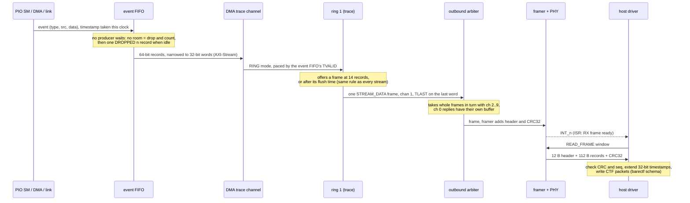

# pio2 Interconnect: Host Link (SPI / Dual-SPI), Channels, AXI4-Lite, AXI-Stream, DMA, Trace

Status: specification; implemented so far: the tile's AXI4-Lite port (`[SPEC-AXI-04]`) and the
event FIFO (`[SPEC-TRC-01]`) (2026-10-29). Requirements carry tags; code that
implements one carries `@impl [SPEC-xxx-nn] docs/INTERCONNECT_SPECIFICATION.md`.

## 1. Idea

The PIO IP looks to the host like a small network interface: one SPI link (single or dual data
lines) carries **numbered channels**, like ports. Channel 0 is addressed register access (read and
write any register address); the other channels are **streams** (data to and from the PIO through
DMA rings, and the trace). An interrupt pin tells the host which channel needs service.

Inside the FPGA (decision 2026-10-29): **AXI4-Lite** is the control plane (registers) and
**AXI-Stream** the data plane (FIFO data, DMA, trace), everywhere, including the PIO tile's own
register port. There is **no Wishbone and no TLP in pio2**. The same buses face the Zynq PS directly,
and the verification can use proven AXI tools (`[SPEC-VER-01]`). AbstractX, which still uses Wishbone
and TLP inside, bridges to pio2 in its own wrapper (`[SPEC-ICN-09]`).

Block diagrams: [`overview.md`](overview.md) (whole FPGA, host link, tile and DMA, trace path).

### Block diagram

The block diagrams (whole FPGA, host link, tile and DMA, trace path) are kept in one place:
[`overview.md`](overview.md). This section keeps the trace sequence, because it is the
contract between `[SPEC-TRC-01]`, `[SPEC-TRC-02]` and `[SPEC-LINK-08]`.

On the Zynq the SPI link is not built: the PS GP port drives the core's AXI4-Lite slave, the AXI MCDMA
takes the core's stream output (trace and rings, channel in `TDEST`) into DDR, and the interrupt is a
PL-to-PS line (`[SPEC-ICN-11]`).

### How the trace reaches the host

barectf is **not** in the FPGA. The FPGA only makes small fixed records; the host turns them into CTF.

So the trace is just channel 1: a stream like the DMA rings, merged with them **one whole frame at a
time** by the outbound arbiter, never interleaved inside a frame. The framer does not care which
channel a frame came from; the `chan` byte in the header tells the host. The registers that control
the trace (type mask, level, dropped count, flush time) sit in the `0x2000` window on the
AXI4-Lite crossbar, like every other block.

## 2. Buses

### `[SPEC-AXI-01]` Control Plane: AXI4-Lite
* **Requirement**: every register block is an AXI4-Lite slave: 32-bit data, byte addresses, `WSTRB`
  per byte, `PROT` ignored, responses `OKAY` or `SLVERR` (`DECERR` from the crossbar for an unmapped
  address). All five channels follow AXI4 rules (AMBA AXI and ACE spec, IHI 0022, section A3): a
  source keeps `VALID` and its payload stable until `READY`; `VALID` never waits for `READY`; write
  address and write data are accepted in any order or together; one `B` response per write, one `R`
  per read; no combinational path from an input `VALID` to an output `READY` that could deadlock.
* **Requirement**: every slave sustains one transaction per clock when its master and the crossbar allow
  it (back-to-back, no forced idle cycle), and holds at most `N_OUTSTANDING` (default 2) per direction.
* **Verified by**: `formal-check` (ZipCPU AXI4-Lite properties on every master and slave port),
  `cocotb-regression` (cocotbext-axi master / monitor, randomized `READY` / `VALID` gaps, 1000
  transactions per slave, functional coverage of the handshake orders)
* **Implementation Target**: `src/rtl/axi/`

### `[SPEC-AXI-02]` Data Plane: AXI-Stream
* **Requirement**: FIFO data, DMA transfers, link stream channels and the trace use AXI-Stream (AMBA
  AXI4-Stream spec, IHI 0051): 32-bit `TDATA`, `TVALID` / `TREADY`, `TLAST` at the end of a block
  (a DMA block, a link frame's payload, a trace packet), optional `TKEEP` for a partial last word,
  `TUSER` for errors where stated. `TVALID` and its data stay stable until `TREADY`.
* **Requirement (pacing)**: a PIO TX FIFO's `TREADY` is "not full" and an RX FIFO's `TVALID` is "not
  empty", so the AXI-Stream handshake is the data request (RP2040 DREQ) and nothing else is needed.
* **Verified by**: `formal-check` (ZipCPU AXI-Stream properties on every port), `cocotb-regression`
  (cocotbext-axi source / sink with random back-pressure, `TLAST` framing checked, no word lost or
  duplicated over 1000 blocks)
* **Implementation Target**: `src/rtl/axi/`, `src/rtl/dma/`

### `[SPEC-AXI-03]` AXI4-Lite Crossbar and Address Map
* **Requirement**: one master per build, the core boundary's AXI4-Lite slave (`[SPEC-ICN-11]`), driven
  by the host adapter: the SPI link's channel-0 master or the Zynq PS GP port. Slaves: PIO tile front
  end, DMA registers, event FIFO / trace registers, `ISR` / `IMR` and link registers; `DECERR` on an unmapped address; a slow slave never blocks a transaction to another one.
* **Requirement (address map, base 0x0000_0000, 4 KB windows)**:

  | Window | Slave |
  | :--- | :--- |
  | `0x0000` | PIO tile registers (as today: CTRL, FSTAT, FDEBUG, IRQ, SMx_*, TXFx/RXFx, INSTR_MEM) |
  | `0x1000` | DMA engine registers (per channel) |
  | `0x2000` | event FIFO / trace registers |
  | `0x3000` | link registers (version, channel status, interrupt mask, error counters) |
* **Verified by**: `cocotb-regression` (`tests/cocotb/test_axil_xbar_cocotb.py`: `DECERR`, slow slave
  does not block others), `formal-check`
* **Implementation Target**: `src/rtl/axi/pio2_axil_xbar.sv`

### `[SPEC-AXI-05]` Reuse Proven AXI Building Blocks
* **Requirement**: generic AXI blocks are reused, not rewritten, from:
  * Alex Forencich, `verilog-axi` and `verilog-axis` (<https://github.com/alexforencich>, MIT):
    AXI4-Lite crossbar / interconnect, AXI-Stream FIFOs (synchronous and asynchronous), arbiters and
    muxes, register slices;
  * ZipCPU (Dan Gisselquist), `wb2axip` (<https://github.com/ZipCPU/wb2axip>, Apache-2.0): the formal
    property files (`[SPEC-VER-01]`) and bridges such as `wbm2axilite` (used by AbstractX's wrapper,
    `[SPEC-ICN-09]`).
* **Requirement**: each is a git submodule under `third_party/` at a pinned commit, listed in
  `docs/third_party.md` with its link, author, license and what pio2 uses it for; pio2 instantiates
  them and does not copy or edit them. License obligations (MIT notice; Apache-2.0 license text, no
  modification, NOTICE if present) are met as that file describes, and re-checked when a pin moves. Our own checks (formal properties,
  cocotbext-axi tests, coverage) run on every place we integrate one, so reuse never means untested.
* **Requirement**: pio2 writes only what is specific to it: the PIO tile, the SPI PHY and framer, the
  channel mux, the DMA engine, the event FIFO.
* **Verified by**: `cocotb-regression` (each integrated block under our tests), `formal-check`
* **Implementation Target**: `third_party/`, `docs/third_party.md`, `LICENSES/`, `src/rtl/`

### `[SPEC-AXI-04]` The PIO Tile's Register Port Is AXI4-Lite
* **Requirement**: `asp_pio_tile`'s register port is an AXI4-Lite slave (`[SPEC-AXI-01]`) with the same
  register map as before (CTRL, FSTAT, FDEBUG, IRQ, SMx_*, TXFx / RXFx, INSTR_MEM). Its Wishbone port is
  removed; pio2 contains no Wishbone. AbstractX connects its Wishbone master through a Wishbone to
  AXI4-Lite bridge in its own wrapper (`[SPEC-ICN-09]`).
* **Requirement (front end)**: write address and write data are accepted in either order or together;
  one register access reaches the register block at a time (reads and writes alternate when both
  wait); the next request is accepted only after the previous response was taken, so a register with
  a side effect (TX FIFO write, RX FIFO read, SMx_INSTR) acts exactly once per transaction. Registers
  are whole 32-bit words: a write with `WSTRB` other than `4'hF` changes nothing and answers `SLVERR`.
* **Requirement**: the move keeps behaviour: every existing tile test (tile, conformance, DShot, ESC
  serial) passes through the AXI4-Lite port, driven by cocotbext-axi, before and after.
* **Verified by**: `cocotb-regression` (all tile suites through the AXI4-Lite port), `formal-check`
  (ZipCPU `faxil_slave` on the tile port)
* **Implementation Target**: `src/rtl/asp_pio_tile.sv`

## 3. Host link

### `[SPEC-LINK-01]` SPI PHY: Single and Dual, Chosen per Window
* **Requirement**: SPI mode 0. Each CS_n window starts with one command byte on IO0 (always single):
  `0x01 WRITE_FRAME` (host sends one frame, `[SPEC-LINK-02]`) or `0x02 READ_FRAME` (FPGA returns the
  next queued frame, or an empty frame of length 0 when none is queued), with bit 7 `D` selecting the
  rest of the window: single (MOSI = IO0, MISO = IO1) or dual (IO0 and IO1 both carry data, 2 bits
  per clock; one turnaround clock before the FPGA drives). The FPGA returns the low byte of `ISR`
  during the command byte, so every window also tells the host what is pending.
* **Requirement (clocking, 2026-10-29)**: SCK clocks the PHY's shift registers directly (its own clock
  domain); bytes cross to the system clock through a small asynchronous FIFO (Gray-coded pointers,
  2-flop synchronisers), never by sampling SCK with the system clock. SCK is independent of f_sys,
  limited only by the pins and the board wiring.
* **Requirement (throughput)**: at least **10 MB/s of payload** on Dual SPI (about 50 MHz SCK: 100 Mbit/s
  raw, ~11 MB/s after the 12-byte header and CRC per 128-byte frame), sustained in both directions on a
  Tang Nano 20K, with the host and wiring stated. Single SPI gives half. Quad SPI is a later option if
  more is needed.
* **Rationale**: sampling SCK at f_sys / 4 (the first draft) caps a 27 MHz Tang at ~1.5 MB/s on Dual
  SPI, below the goal; the internal buses are not the limit (32-bit AXI-Stream at 27 MHz is
  ~108 MB/s).
* **Requirement**: pins as separate `_i`, `_o`, `_oe` signals at the IP boundary; tristate only in
  the board top (the same rule the PIO pins follow).
* **Verified by**: `cocotb-regression` (`tests/cocotb/test_link_phy_cocotb.py`: single and dual, SCK unrelated to and faster than f_sys, async FIFO under randomized clock ratios), `formal-check` (async FIFO pointers), `board-bringup` (10 MB/s measured, SCK limit per board)
* **Implementation Target**: `src/rtl/link/pio2_spi_phy.sv`, `src/rtl/link/pio2_async_fifo.sv`

### `[SPEC-LINK-02]` Frames: At Most 128 Bytes, CRC32, Like a NIC
* **Requirement**: the link carries **frames** of at most 128 bytes, framed by CS_n. A framer on each
  side checks and adds a CRC32 (CRC-32/ISO-HDLC, the Ethernet polynomial `0x04C11DB7`, reflected,
  init and final XOR `0xFFFFFFFF`) over header and payload. A frame whose CRC fails is dropped whole
  and counted; nothing of it reaches a bus or a ring.
* **Requirement (frame layout, little endian)**:

  | Offset | Size | Field |
  | :--- | :--- | :--- |
  | 0 | 1 | `op` (`[SPEC-LINK-03]`) |
  | 1 | 1 | `chan` (channel / port number) |
  | 2 | 1 | `flags` (bit 0 constant address for register ops; bit 1 dual data phase for the reply) |
  | 3 | 1 | `seq` (sequence number; replies echo it, so the host matches answers and sees loss) |
  | 4 | 2 | `len` payload length in bytes (0..116, multiple of 4 for word data) |
  | 6 | 2 | reserved, 0 |
  | 8 | 4 | `addr` (register ops only; otherwise absent) |
  | 8 or 12 | `len` | payload |
  | end | 4 | CRC32 |

  So a frame carries at most 116 bytes (29 words) of payload with no address, 112 bytes (28 words)
  with one; larger transfers are several frames.
* **Requirement (ops)**: `REG_READ`, `REG_WRITE` (channel 0, incrementing or constant address),
  `STREAM_DATA` (a stream channel's payload, either direction), `STATUS` (no payload; the reply
  carries ISR, queue levels and per-channel credits), `ACK` / `NAK` (reply to a write, with the
  `seq` and an error code).
* **Requirement (transactions)**: the SPI master always drives the clock, so a transaction is: host
  writes one frame (command), the FPGA queues the reply frame, the host reads it in a later CS_n
  window (signalled by `INT_n` or by polling `STATUS`). Host-to-FPGA and FPGA-to-host frames use
  separate queues, so the host can write the next command while a reply is waiting.
* **Verified by**: `cocotb-regression` (`tests/cocotb/test_link_framer_cocotb.py`: CRC32 known vectors, bad CRC dropped whole, 128-byte limit), `host-tests` (driver framing)
* **Implementation Target**: `src/rtl/link/pio2_link_framer.sv`, `src/pio2/host/frame.py`

### `[SPEC-LINK-07]` NIC-Style Register Model
* **Requirement**: the link block is controlled like a small NIC, through registers in the link
  window (`0x3000`) that both the host (as `REG_*` frames) and the simulator can read:

  | Register | Meaning |
  | :--- | :--- |
  | `ID` / `VERSION` | magic and protocol version, so the host checks it talks to the right IP |
  | `CTRL` | enable, reset queues, SPI mode (dual allowed), `RD_WAIT` |
  | `ISR` | interrupt status, write 1 to clear: RX frame ready, TX queue space, stream threshold, DMA done, DMA error, CRC error, overflow, trace dropped |
  | `IMR` | interrupt mask; `INT_n` = any (`ISR` and `IMR`) |
  | `TXQ_LEVEL` / `RXQ_LEVEL` | frames waiting in each direction |
  | `RX_FRAME_LEN` / `RX_FRAME_CHAN` | header of the next reply frame, without consuming it |
  | `CRC_ERR` / `LEN_ERR` / `OVERFLOW` / `DROPPED` | error counters (saturating, clear on write) |
  | `STREAM_THR[n]` | per stream channel: interrupt threshold in words |

* **Requirement (frame buffers)**: at least two frame buffers per direction (128 bytes each) so the
  host can stream back to back; buffer count is a build parameter and is reported in `CTRL`.
* **Verified by**: `cocotb-regression` (register map read/write, counters saturate and clear)
* **Implementation Target**: `src/rtl/link/pio2_link_regs.sv`

### `[SPEC-LINK-03]` Channels Are Ports
* **Requirement**: channel numbers (frame `chan`): channel 0 = registers (addressed); channel 1 = trace stream (out, `[SPEC-TRC-*]`);
  channels 2..9 = the eight DMA stream rings (`[SPEC-DMA-*]`), direction from the DMA channel's
  configuration. Unused channels answer with an error status.
* **Requirement**: a stream channel never needs an address: like a socket, the host only says "give me
  up to N words" or "take these N words".
* **Verified by**: `cocotb-regression` (`tests/cocotb/test_link_channels_cocotb.py`)
* **Implementation Target**: `src/rtl/link/pio2_link_mux.sv`

### `[SPEC-LINK-08]` Outbound Frames Are Merged Whole
* **Requirement**: frames to the host come from channel 0 (register replies, `ACK` / `NAK`, `STATUS`),
  channel 1 (trace, `[SPEC-TRC-02]`) and channels 2..9 (out streams). One arbiter fills the outbound
  frame buffers (`[SPEC-LINK-07]`) one **whole frame** at a time; a frame is never interleaved with
  another, and the framer adds the header and CRC32 the same way for every channel.
* **Requirement (order)**: one outbound buffer is reserved for channel 0, so a register reply never
  waits behind stream data; channels 1..9 arrive already merged from the core's AXI-Stream output
  (`[SPEC-ICN-11]`: whole `TLAST` blocks, round robin, so the trace cannot starve a stream and a stream
  cannot starve the trace) and fill the other buffers, one block per frame. A stream channel offers a
  frame when it has a full frame of words or, with fewer, after its flush time.
* **Rationale**: whole frames keep each frame's CRC and `chan` meaningful; the reserved buffer keeps
  register access latency bounded while streams run at full rate.
* **Verified by**: `cocotb-regression` (`tests/cocotb/test_link_channels_cocotb.py`: all channels busy
  at once, every frame whole and in channel order, register reply latency bounded, round robin share)
* **Implementation Target**: `src/rtl/link/pio2_link_mux.sv`

### `[SPEC-LINK-04]` Flow Control by Credits
* **Requirement**: the `STATUS` reply returns, per channel, words available (out) or words free (in). The host
  never sends more than the free count; the FPGA never returns more than it has. Neither side can
  overflow the other; an attempted overflow is a counted error, not data loss.
* **Verified by**: `cocotb-regression` (credits never exceeded; overflow counted, no data loss)
* **Implementation Target**: `src/rtl/link/pio2_link_mux.sv`, `src/pio2/host/driver.py`

### `[SPEC-LINK-05]` Interrupt Pin and Status
* **Requirement**: `INT_n` (active low, level) = any bit of (`ISR` and `IMR`) (`[SPEC-LINK-07]`):
  a reply frame queued, an out stream at or above `STREAM_THR`, an in stream with at least
  `STREAM_THR` free, a DMA channel done or in error, a link error, trace dropped. The host reads `ISR`
  (in the first byte of any window, or with `STATUS`), services the causes, and writes 1 to clear
  them; a cause that is still true sets its bit again, so no interrupt is lost.
* **Verified by**: `cocotb-regression` (every ISR cause sets INT_n; W1C; a still-true cause re-asserts)
* **Implementation Target**: `src/rtl/link/pio2_link_regs.sv`

### `[SPEC-LINK-06]` The Same Link in Simulation
* **Requirement**: the simulator (`docs/DEBUGGER_SPECIFICATION.md`) can drive the link at the SPI pins (bit for bit
  what a host does) or call the channels directly (fast). Both go through the same Python host
  driver, so a host program tested against the simulator runs unchanged on a board.
* **Verified by**: `host-tests` (`tests/test_host_driver.py`: same results through pins and direct)
* **Implementation Target**: `src/pio2/host/driver.py`

## 4. DMA

### `[SPEC-DMA-01]` Channels Paced by the PIO FIFOs
* **Requirement**: eight PIO channels plus one trace channel. Each PIO channel moves 32-bit words
  between a ring buffer in RAM and one PIO FIFO (TX of SM n, or RX of SM n); the trace channel moves
  event records from the event FIFO into ring 1 (`[SPEC-TRC-02]`). Every channel is paced by that FIFO's data request (TX not full / RX not empty),
  as RP2040 DMA is paced by DREQ; both sides are AXI-Stream (`[SPEC-AXI-02]`), so the FIFO's handshake
  is the pacing.
* **Requirement (modes)**: `ONE_SHOT` (N words, then done), `RING` (continuous; ring wraps),
  `TRIGGERED` (each trigger moves one block of N words; trigger = a PIO IRQ flag or an input pin, e.g.
  IMU DRDY), `DIRECT` (no ring: the link stream feeds or drains the FIFO directly, back-pressured by
  `TREADY`; low latency, low rate).
* **Requirement (counters)**: per channel: words moved, underruns (TX FIFO wanted data, ring empty),
  overruns (RX FIFO had data, ring full), each counted and each producing a trace event. Channels share
  the ring RAM by round robin, at most `MAX_BURST` (default 16) words per turn.
* **Verified by**: `cocotb-regression` (`tests/cocotb/test_dma_cocotb.py`: each mode, DREQ pacing, underrun/overrun counted, 1000-block steady state)
* **Implementation Target**: `src/rtl/dma/pio2_dma.sv`

### `[SPEC-DMA-02]` Rings Connect DMA and Link Streams
* **Requirement**: each stream channel's ring is one producer / one consumer (link side and DMA side),
  with read/write indices in registers; its levels feed the link credits (`[SPEC-LINK-04]`) and the
  interrupt thresholds (`[SPEC-LINK-05]`).
* **Requirement (examples it must carry)**: DShot / bidirectional DShot frames out on a RING channel;
  ESC serial bytes in both directions; IMU auto-DMA: DRDY triggers a PIO SPI burst, a TRIGGERED RX
  channel moves each sample block into a ring, the host collects batches on interrupt.
* **Verified by**: `cocotb-regression` (DShot ring out, ESC serial both ways, IMU triggered burst in, end to end)
* **Implementation Target**: `src/rtl/dma/pio2_dma.sv`, `src/rtl/dma/pio2_ring_ram.sv`

## 5. Trace (barectf)

### `[SPEC-TRC-01]` Event FIFO With Fixed Records
* **Requirement**: `N_PROD` producers (PIO tile, DMA engine, link, ...) each offer one record at a time
  (`valid` with `type`, `src`, `data`; no `ready`: **no producer ever waits**). The timestamp is taken
  in the clock the event is offered. Each producer has a one-record holding slot; the slots drain into
  one FIFO, one record per clock, by fixed priority (producer 0 highest: errors > DMA > PIO > link). An
  event offered while its producer's slot is still full is **dropped and counted**; when the drop count
  is non-zero, a `DROPPED` record (`data` = count, saturating; timestamp = the clock of the first lost
  event) is written in a clock when no slot is waiting (lowest priority), so reporting losses never
  causes more of them; the saturating 32-bit total stays exact. Records leave in priority order, not
  strictly in time order; each carries its own timestamp and the host orders them (`[SPEC-TRC-02]`).
  Type codes above `0x1F` are ignored (not recorded, not counted).
* **Requirement (record, 64 bits)**: `[15:0] data` (PC, word count, IRQ number, drop count, ...),
  `[23:16] src` (SM or DMA channel), `[31:24] type`, `[63:32] timestamp` (system clocks, wraps; the host
  extends it to 64 bits). On the link a record is two 32-bit words, bits `[31:0]` first.
* **Requirement (types)**:

  | Code | Type | Code | Type |
  | :--- | :--- | :--- | :--- |
  | `0x01` / `0x02` | SM stall begin / end (`data`: reason, PC) | `0x08` / `0x09` | DMA burst begin / done |
  | `0x03` / `0x04` | IRQ flag set / clear | `0x0A` / `0x0B` | DMA underrun / overrun |
  | `0x05` / `0x06` | FIFO full / empty edge | `0x0C` | DMA trigger |
  | `0x10` | link frame error | `0x1F` | `DROPPED` (`data` = records lost, saturating) |

  Per-instruction events exist in simulation only (`[SPEC-DBG-13]`): at full speed they would fill the
  FIFO. Field layouts per type live in the barectf schema (`[SPEC-TRC-02]`).
* **Requirement (enable)**: a 32-bit type mask, one bit per type code `0x00..0x1F`; a masked event is not
  recorded and not counted as dropped, so tracing off costs no bandwidth. `DROPPED` is always enabled.
* **Requirement (status)**: FIFO level and a saturating 32-bit total of dropped records, for the
  `0x2000` register window.
* **Requirement (reuse, `[SPEC-AXI-05]`)**: the FIFO is Forencich `axis_fifo` (64-bit, depth a build
  parameter, default 512 records); pio2 writes only the slots, the priority and the drop logic. The
  record stream is 64 bits wide inside; a Forencich `axis_adapter` narrows it to the 32-bit DMA stream
  (bits `[31:0]` first).
* **Verified by**: `cocotb-regression` (`tests/cocotb/test_pio2_event_fifo_cocotb.py`: priority,
  drop-and-count with a `DROPPED` record in the right place, mask, random back-pressure, no record lost
  or duplicated that was not counted, 1000-event steady state)
* **Implementation Target**: `src/rtl/trace/pio2_event_fifo.sv`

### `[SPEC-TRC-02]` Records Become barectf CTF on the Host
* **Requirement (path, project owner 2026-10-29)**: the trace goes through the DMA engine like any other
  stream, so it works the same on every host: the event FIFO is the source of a dedicated DMA trace
  channel (`[SPEC-DMA-01]`) in `RING` mode, which moves the records into ring 1. Ring 1 is the
  channel-1 out stream: on the SPI link it reaches the host through the outbound arbiter
  (`[SPEC-LINK-08]`), up to 14 records (112 bytes) per `STREAM_DATA` frame; on the Zynq through
  the core's stream output and the AXI MCDMA (`[SPEC-ICN-11]`). It offers a frame when full or after its flush
  time, so a quiet trace still reaches the host. There is no separate trace packer.
* **Rationale**: one path for SPI and Zynq; the ring gives deep buffering (BRAM) in front of a slow
  link; levels, thresholds, interrupts and counters are the ones every stream already has.
* **Requirement**: channel 1 streams the records; the host driver converts them into CTF 1.8 packets
  with a barectf schema (`src/pio2/trace/barectf_config.yaml`, aligned with AbstractX's
  `pio_event`), so simulation and board traces are the same and open in babeltrace2, Trace Compass
  and AbstractX Studio.
* **Verified by**: `host-tests` (records -> CTF, read back with babeltrace2)
* **Requirement (order)**: the host sorts records by their extended timestamp before writing CTF
  packets, because the event FIFO emits them in priority order (`[SPEC-TRC-01]`).
* **Implementation Target**: `src/rtl/dma/pio2_dma.sv` (trace channel), `src/pio2/trace/ctf.py`, `src/pio2/trace/barectf_config.yaml`

## 6. Integration and tests

### `[SPEC-ICN-09]` Tile Split: TLP Adapters Out, AXI-Stream FIFO Ports and Event Port In
* **Requirement**: `asp_pio_tile` loses its TLP ingress / egress adapters; they move to an AbstractX-side
  wrapper (with AbstractX's Wishbone to AXI4-Lite bridge, `[SPEC-AXI-04]`) that keeps AbstractX's TLP
  router, its Wishbone fabric and its TLP-path test working unchanged. The tile gains,
  per state machine, an AXI-Stream TX input and RX output on its FIFOs (`[SPEC-AXI-02]` pacing) and an
  event output for `[SPEC-TRC-01]`. Register access to the FIFOs stays (TXFx / RXFx) for software that
  does not use DMA.
* **Verified by**: `cocotb-regression` (tile tests through the AXI-Stream FIFO ports; AbstractX wrapper
  passes AbstractX's TLP-path test)
* **Implementation Target**: `src/rtl/asp_pio_tile.sv`

### `[SPEC-ICN-11]` Host Adapters: SPI Link for Tang, Native AXI for Zynq
* **Requirement**: the core (AXI4-Lite crossbar, DMA engine, rings, event FIFO, PIO tile) is the same on
  every board; only the host adapter changes, and a build has exactly one: the **SPI link**
  (`[SPEC-LINK-*]`, an external CPU over SPI / Dual-SPI: Tang Nano 9K / 20K with a Pico, an SBC or the
  Cubie) or the **Zynq-7000** PS (no SPI at all). Diagrams: `docs/overview.md`.
* **Requirement (which adapter, project owner 2026-10-29)**: the SPI link is optional, chosen per board:

  | Board | SPI link | Zynq adapter | Why |
  | :--- | :--- | :--- | :--- |
  | Tang Nano 9K / 20K (Gowin, no CPU on chip) | **required** | none | the host is outside the FPGA (Pico, SBC, Cubie) |
  | Zynq-7000 | **not built** | **required** | the ARM cores are on the chip, on AXI |
  | any other FPGA with an external host | required | none | as the Tang boards |
  | simulation (Verilator) | at the pins, or bypassed (`[SPEC-LINK-06]`) | none | same driver either way |

* **Requirement (core boundary, 2026-10-29)**: `pio2_core` has exactly four host-facing interfaces, and
  both host adapters attach to them unchanged:
  1. one AXI4-Lite slave (all registers, `[SPEC-AXI-03]` map);
  2. one AXI-Stream input, 32-bit, channel number in `TDEST` (2..9), `TLAST` per block;
  3. one AXI-Stream output, 32-bit, channel number in `TDEST` (1..9), whole `TLAST` blocks merged
     inside the core by Forencich `axis_arb_mux` (trace ring and out rings, round robin);
  4. one interrupt (any `ISR` and `IMR`).
* **Requirement (SPI adapter)**: PHY, framers, CRC32, an AXI4-Lite master for channel 0, and the
  frame / block conversion (channel in the frame header <-> `TDEST`); it puts channel-0 replies first
  (`[SPEC-LINK-08]`) and drives `INT_n` from the interrupt.
* **Requirement (Zynq adapter)**: no pio2 RTL. The PS GP port reaches the AXI4-Lite slave through the
  Xilinx AXI interconnect / protocol converter; the Xilinx AXI MCDMA (one DMA channel per pio2 channel,
  routed by `TDEST`) connects the two streams to DDR through an HP port; the interrupt goes to
  `IRQ_F2P`.
* **Requirement**: the host driver (`[SPEC-LINK-06]`) has an SPI back end and a Zynq back end (UIO mmap
  for the registers, a DMA buffer for the streams) with the same channel API.
* **Verified by**: `cocotb-regression` (the core through its boundary with each adapter's traffic pattern), `board-bringup`
  (Zynq: registers and one stream through the PS)
* **Implementation Target**: `src/rtl/pio2_core.sv`, `src/pio2/host/zynq.py`

### `[SPEC-ICN-12]` On the Tang Boards the PIO Replaces the Hardwired Cores
* **Goal (project owner, 2026-10-29)**: DShot, bidirectional DShot, ESC serial passthrough and UART are
  PIO programs on the Tang Nano 9K / 20K, not dedicated RTL. The AbstractX cores they replace
  (`asp_dshot_core`, `asp_uart_core`, the ESC passthrough path, `asp_pwm_decoder`) are not part of the
  pio2 Tang tops.
* **Requirement**: each replaced function has a PIO program in `src/programs/` with a cocotb timing test
  against the protocol (as `dshot_bidir` and `esc_serial` have today) and a board test, and the pins
  it uses are owned by the PIO through the pin mux (`[SPEC-PIO-09]`).
* **Verified by**: `cocotb-regression` (per program), `fpga-fit` (the Tang tops fit without the old
  cores), `board-bringup` (motor and ESC on a Tang)
* **Implementation Target**: `src/programs/`, `boards/tang_nano9k/`, `boards/tang_nano20k/`

### `[SPEC-VER-01]` Full Validation: Formal Properties, UVM-Style Testbenches, Coverage
* **Goal (project owner, 2026-10-29)**: full validation of every bus port and block, not only directed
  tests.
* **Requirement (formal)**: every AXI4-Lite and AXI-Stream port carries the ZipCPU formal property
  sets (Dan Gisselquist, `wb2axip`: `faxil_slave`, `faxil_master`, `faxis_master`, `faxis_slave`; from
  the `third_party/wb2axip` submodule at its pinned commit, Apache-2.0, `docs/third_party.md`) and is
  proved with SymbiYosys: bounded model check to a stated depth and k-induction where it closes; the
  async FIFO pointers and the CRC32 framer have their own properties. Every proof is shown to fail on
  a deliberately broken copy of the block.
* **Requirement (simulation)**: cocotb testbenches built UVM-style with **pyuvm** (sequences, drivers,
  monitors, scoreboard, environment per block), using **cocotbext-axi** for AXI4-Lite and AXI-Stream
  masters, slaves and monitors, constrained-random sequences, random back-pressure on every
  `READY`, and a reference model per block (scoreboard compares).
* **Requirement (coverage)**: functional coverage with **cocotb-coverage**: per AXI port the handshake
  orders (AW before W, W before AW, together; READY before VALID and after), back-pressure lengths,
  responses; per block its modes and error paths (CRC fail, overflow, underrun, drop). A block is
  done when every cover point is hit, recorded per run.
* **Requirement (steady state)**: 1000 transactions or blocks per test, with no growth in any queue or
  counter that should return to zero.
* **Requirement (system)**: an end-to-end test with the Python host driver speaking single and dual SPI
  to the whole core, running the three `[SPEC-DMA-02]` examples. Resource use (LUT / FF / BRAM) on Tang
  Nano 9K and 20K recorded per change.
* **Verified by**: `formal-check`, `cocotb-regression`, `fpga-fit`
* **Implementation Target**: `tests/formal/`, `tests/cocotb/`, `tests/uvm/`
