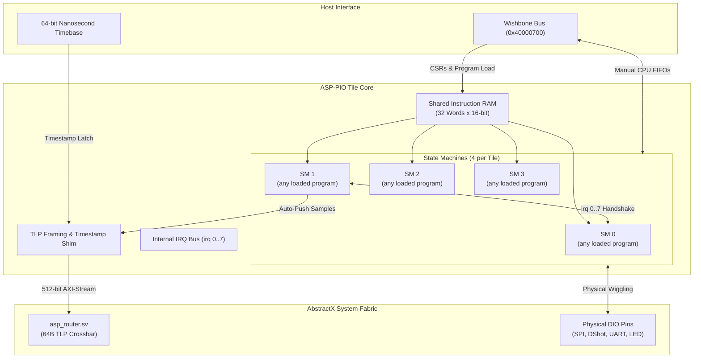

# pio2 Programmable I/O (PIO) Engine Specification

```
Document:    docs/SPECIFICATION.md
Status:      Active / SSOT
Governs:     src/rtl/asp_pio_tile.sv, src/rtl/asp_pio_sm.sv, src/rtl/asp_pio_tlp_shim.sv, src/rtl/asp_pio_tlp_ingress.sv, src/programs/, tests/cocotb/test_asp_pio_cocotb.py, tests/cocotb/test_asp_pio_conformance_cocotb.py, src/programs/examples/, src/pio2/examples.py
Last Update: 2026-10-29 (moved from AbstractX rtl/pio)
```

> **Scope after the move (2026-10-29).** This repository holds the PIO tile, its programs, tests and
> tools. Requirements that name `rtl/asp_top.sv`, `hw/<board>/...`, `tools/pin_map.py` or
> `tools/check_register_parity.py` (board integration: [SPEC-PIO-09] pins, register parity) are
> implemented in [AbstractX](https://github.com/tcmichals/AbstractX), which uses this repository as a
> submodule. Skill names in `Verified by` lines (`cocotb-regression`, `rtl-lint`, `fpga-fit`) are
> AbstractX skills; here they map to `tests/cocotb/` (see README).

---

## 1. Overview & Architecture

The AbstractX Programmable I/O (**ASP-PIO**) engine is a high-speed, synthesizable SystemVerilog hardware subsystem designed to offload physical pin serialization, sensor protocol handshakes, and actuator timing from the main CPUs (AArch64 host, XuanTie E906, and Cortex-M33).

It implements the proven **RP2040 16-bit PIO Instruction Set Architecture (ISA)** augmented with **AbstractX 64-Byte TLP Stream Integration** and **Supervisor-Worker State Machine Chaining**.



---

## 2. Formal Requirements

### `[SPEC-PIO-01]` Quad-State Machine Tile Architecture
* **Requirement**: The PIO block MUST instantiate four (4) independent, concurrent State Machines (SM0..SM3) sharing a 32-word x 16-bit dual-port instruction memory. Each state machine operates on an independent fractional 16-bit clock divider (`div_int[15:0]`, `div_frac[7:0]`), supporting execution speeds from the full fabric clock (e.g. 100 MHz) down to sub-kHz rates.
* **Implementation Target**: `src/rtl/asp_pio_tile.sv`, `src/rtl/asp_pio_sm.sv`
* **Verified by**: `cocotb-regression`, `rtl-lint`

### `[SPEC-PIO-00]` Configurable Fabric: No Protocol Logic in the FPGA
* **Decision (project owner, 2026-10-27)**: the FPGA is configured by loading PIO code, never by
  changing RTL. Every pin function (DShot in any variant, bidirectional DShot, PWM/OneShot, the ESC
  4-way passthrough UART, SPI/IMU, LED, RC input) is a PIO program plus its configuration (clock
  divider, pin mapping, shift control), loaded by the host at run time over CONTROL TLPs. Choosing
  another protocol or rate needs no new bitstream.
* **Requirement**: RTL provides only generic resources: PIO tiles ([SPEC-PIO-01]), generic
  bidirectional pins ([SPEC-PIO-09]), generic AXI-Stream FIFO ports and DMA channels
  (`[SPEC-ICN-09]`, `[SPEC-DMA-01]` in `INTERCONNECT_SPECIFICATION.md`) and program
  loading ([SPEC-PIO-11]). No module may encode a protocol (bit timing, framing, command words,
  telemetry decode). Protocol knowledge lives in `src/programs/*.pio` and host software.
* **Requirement (migration)**: the dedicated cores `asp_dshot_core`, `asp_uart_core`,
  `asp_neopixel_core`, `asp_pwm_decoder` and `asp_imu_auto_dma` are removed once a PIO program
  passes a cocotb timing-parity test against the behaviour it replaces. First: motors and ESC
  passthrough ([SPEC-PIO-12], [SPEC-PIO-13]).
* **Verified by**: `rtl-lint`, `cocotb-regression`
* **Implementation Target**: `rtl/asp_top.sv`, `src/rtl/asp_pio_tile.sv`

### `[SPEC-PIO-02]` Standard RP2040 16-Bit Instruction Set Compatibility
* **Requirement**: Each state machine MUST implement the exact 16-bit RP2040 instruction encoding, supporting all 9 core operations:
  1. `JMP` (`000`): Conditional branch (`!X`, `X--`, `!Y`, `Y--`, `X!=Y`, `PIN`, `!OSRE`).
  2. `WAIT` (`001`): Cycle-exact stall on GPIO pin, mapped pin, or internal IRQ flag.
  3. `IN` (`010`): Shift 1 to 32 bits from source (pins, X, Y, null, ISR, OSR) into ISR.
  4. `OUT` (`011`): Shift 1 to 32 bits from OSR to destination (pins, X, Y, null, pindirs, PC, ISR, exec).
  5. `PUSH` / `PULL` (`100`): Move words between ISR/OSR and 4-word deep RX/TX FIFOs.
  6. `MOV` (`101`): Move/invert/bit-reverse data between X, Y, pins, ISR, OSR, and status.
  7. `IRQ` (`110`): Set, clear, and wait on internal IRQ flags.
  8. `SET` (`111`): Direct immediate 5-bit write to pins, pindirs, X, or Y.
* All instructions MUST support concurrent 5-bit delay and side-set pin driving.
* **Requirement (conformance, 2026-10-27)**: programs assembled by the Raspberry Pi `pioasm` run
  unchanged, with RP2040 datasheet semantics (§3.4, §3.5.4, §3.7). In particular:
  1. A blocking `pull`, `push`, `wait`, `irq wait`, an autopush with a full RX FIFO, or an `out`
     with autopull on an empty TX FIFO stalls: the PC does not advance, the delay does not start,
     and the instruction re-executes until it can complete. Side-set is asserted while stalled.
  2. `pull noblock` on an empty TX FIFO copies X into OSR; `push noblock` on a full RX FIFO does
     nothing. `pull ifempty` / `push iffull` act only at the threshold.
  3. Autopush pushes the ISR after the shift; autopull refills OSR when the shift count reaches
     the threshold, and an `out` on an empty OSR with an empty FIFO stalls.
  4. `mov isr, x` clears the ISR shift count; `mov osr, x` sets the OSR count to 0 (full);
     `mov x, status` gives all-ones when the selected FIFO level is below `STATUS_N`, else zero.
  5. `PINCTRL.SIDESET_COUNT` includes the enable bit when `EXECCTRL.SIDE_EN` is set, as in the Pico
     SDK and in the `sideset.size` field of `pioasm -o json`.
  6. `irq wait` sets the flag and waits until it is cleared; `irq rel` maps index `i` to
     `{i[2], (i[1:0] + sm) % 4}`.
  7. `SM_RESTART` (datasheet `CTRL.SM_RESTART`, corrected 2026-10-27, EL-1027-44): clears the ISR,
     sets the input shift count to 0 and the output shift count to 32, clears the delay, the
     `irq wait` state, a pending autopush and a latched `SMx_INSTR` / `OUT`/`MOV EXEC` instruction.
     It does **not** change the PC, OSR, X, Y, the FIFOs or any pin. (The earlier rule also jumped to
     `wrap_bottom`, emptied the FIFOs and released the pins; the Pico SDK's `pio_sm_init` sets pin
     directions before restarting, so that broke rt-fc-offloader's `dshot.cpp`.)
  8. `SHIFTCTRL.FJOIN_TX` [30] / `FJOIN_RX` [31] join both FIFOs into one 8-word FIFO for that
     direction (the other direction then has none); changing either bit empties both FIFOs, which is
     how the Pico SDK's `pio_sm_clear_fifos` works. Found missing on 2026-10-27 by the pico-examples
     and Betaflight UART programs ([SPEC-PIO-14]).
  9. An `SMx_INSTR` instruction that stalls stays latched until it completes, and
     `EXECCTRL.EXEC_STALLED` [31] reads 1 meanwhile (`pio_sm_exec_wait_blocking`, used by Betaflight's
     OSD driver).
  10. Pin outputs (datasheet 3.5.6, EL-1027-43): the tile holds one output-value latch and one
     direction latch per pin. Each clock, for each pin, the write from the highest-numbered state
     machine that writes it in that clock is applied (side-set beats OUT/SET within one SM); a pin
     no state machine writes keeps its value. After reset every pin is an input with output 0.
* **Verified by**: `cocotb-regression` (`tests/cocotb/test_asp_pio_conformance_cocotb.py`: each rule
  above with `pioasm` output; first failing case on 2026-10-27: `pull block` advanced the PC), `host-tests`
  (`tests/test_isa_every_opcode.py`, 2026-10-29: every RP2040 opcode and operand executed on the
  Verilator model of the RTL and compared with the datasheet rule; a coverage test fails if any
  combination has no case; three RTL mutants caught), `cocotb-regression`
  (`tests/cocotb/test_isa_every_opcode_cocotb.py`, 2026-10-30: the same cases, from the shared table
  `src/pio2/isa_cases.py`, through the AXI4-Lite port on Icarus and on Verilator, with the same
  coverage gate)
* **Implementation Target**: `src/rtl/asp_pio_sm.sv`

### `[SPEC-PIO-03]` Internal IRQ Bus & Supervisor/Worker State Machine Chaining
* **Requirement**: The tile MUST provide an internal 8-bit IRQ flag register (`irq[7:0]`). State machines can set flags (`irq set N`), clear flags (`irq clear N`), and block until cleared (`irq wait N` / `wait 1 irq N`).
* **Supervisor Pattern**: High-level sequencer state machines (e.g. IMU Auto-DMA) trigger low-level bus transceivers (e.g. SPI Worker) via internal IRQs without invoking the main CPU or generating interrupt storms.
* **Implementation Target**: `src/rtl/asp_pio_tile.sv`, `src/rtl/asp_pio_sm.sv`
* **Verified by**: `cocotb-regression`

### `[SPEC-PIO-05]` Register Map (Bus: AXI4-Lite, [SPEC-AXI-04])
* **Bus (2026-10-29)**: this register map moves unchanged from the Wishbone port to an AXI4-Lite slave
  port (`[SPEC-AXI-04]` in `docs/INTERCONNECT_SPECIFICATION.md`); pio2 has no Wishbone. Until that
  change lands the RTL and tests still use the Wishbone port described here.
* **Requirement**: The PIO tile MUST expose this register map, at base address `0x40000700` in AbstractX:
  * `0x00`: Tile Control & Status (`ENABLE[3:0]`, `RESTART[3:0]`).
  * `0x04`: Internal IRQ Status & Clear.
  * `0x08`: FIFO status (read): RX empty `[31:28]`, TX full `[27:24]`.
  * `0x0C`, `0x90`, `0x94`, `0x98`, `0x11C + 0x20 * N`: not used in pio2 (read 0); AbstractX's
    wrapper serves its TLP registers at these offsets (`[SPEC-ICN-09]`).
  * `0x10 .. 0x8C`: Instruction Memory (32 words x 32-bit, lower 16 bits active).
  * `0x100 + 0x20 * N`: SM `N` Clock Divider, RP2040 `CLKDIV` layout (`INT[31:16]`, `FRAC[15:8]`).
  * `0x104 + 0x20 * N`: SM `N` `EXECCTRL`, RP2040 layout (`STATUS_N[3:0]`, `STATUS_SEL[4]`, wrap, `JMP_PIN`, `SIDE_PINDIR`, `SIDE_EN`).
  * `0x108 + 0x20 * N`: SM `N` `SHIFTCTRL`, RP2040 layout (autopush, autopull, in/out dir, thresholds).
  * `0x10C + 0x20 * N`: SM `N` `PINCTRL`, RP2040 layout (`OUT_BASE[4:0]`, `SET_BASE[9:5]`, `SIDESET_BASE[14:10]`, `IN_BASE[19:15]`, `OUT_COUNT[25:20]`, `SET_COUNT[28:26]`, `SIDESET_COUNT[31:29]`).
  * `0x110 + 0x20 * N`: SM `N` TX FIFO (write).
  * `0x114 + 0x20 * N`: SM `N` RX FIFO (read).
  * `0x118 + 0x20 * N`: read SM `N` status (`PC[4:0]`, stalled, active); write = `SMx_INSTR`: the
    instruction runs on the next clock, also while the SM is disabled (used to set pin directions
    and jump to a program's start, as `pio_sm_exec` does).
* Software MUST be able to execute manual SPI or UART byte transfers through SM0 TX/RX FIFOs when autonomous sequencing is idle.
* **Implementation Target**: `src/rtl/asp_pio_tile.sv`
* **Open check** (2026-10-26): a register-map parity check between this table, the RTL decode and the
  software offsets was planned (`tools/check_register_parity.py`, skill `hw-sw-register-parity`), but
  neither was ever committed. Naming the missing skill made this requirement BROKEN and failed CI. It
  comes back here once the skill exists in `.agents/skills/`.
* **Verified by**: `cocotb-regression`

**Moved to AbstractX (2026-10-30, `[SPEC-ICN-09]`)**: the TLP data path with its framing and
timestamps (formerly SPEC-PIO-04 and SPEC-PIO-10) and the tile's TLP trace packets (formerly SPEC-PIO-07)
are AbstractX's: the TLP adapters live in AbstractX's `asp_pio_wrap`, on the tile's AXI-Stream FIFO
ports and observation port. In pio2 the data path is the DMA engine (`[SPEC-DMA-*]`) and the trace is
`[SPEC-TRC-*]` (`INTERCONNECT_SPECIFICATION.md`).

### `[SPEC-PIO-06]` Multi-Rate Primary-Paced IMU Auto-DMA Sequence
* **Requirement**: the tile and the DMA engine read an SPI IMU (ICM-42688-P / BMI270 class) at up to
  8 kHz with no host work per sample:
  1. a PIO program (`src/programs/imu_spi_burst.pio`) waits on the DRDY pin, then clocks one SPI
     burst (command byte, then N data bytes; mode 0) and pushes the received bytes, packed into words,
     into its RX FIFO;
  2. a `TRIGGERED` `OUT` DMA channel (`[SPEC-DMA-01]`) whose trigger is the DRDY pin moves each block
     of words into its ring, timestamped by the trace (`0x0C` trigger, `0x09` block done);
  3. the host collects batches from the ring when the stream threshold interrupt fires
     (`[SPEC-LINK-05]`).
* Total host work per sample during continuous streaming MUST be **zero**: the host only reads
  batches.
* **Verified by**: `cocotb-regression` (`tests/cocotb/test_pio2_core_cocotb.py`: a modelled IMU with
  DRDY, every sample block in order in the ring, sample rate 8 kHz at 27 MHz), `board-bringup`
* **Implementation Target**: `src/programs/imu_spi_burst.pio`, `src/rtl/dma/pio2_dma.sv`

### `[SPEC-PIO-09]` Generic Bidirectional Pins
* **Requirement**: every pad a tile may use is bidirectional at the board top: output value from
  `o_gpio_out`, output enable from `o_gpio_pindir`, and the pad level fed back into `i_gpio`
  through a 2-flop synchronizer. A pad is an input (high-Z) after reset; afterwards only a program or an
  `SMx_INSTR` `set pindirs` changes it ([SPEC-PIO-02] rules 7 and 10). Host software releases a
  motor wire with `set pindirs, 0` before handing it to another program.
  Pull-ups and drive strength come from the board constraints.
* **Requirement (pin map, the only board-specific part)**: each board has one pin map,
  `hw/<board>/pins.toml`, listing for every PIO pad: tile, tile pin number, package pin, I/O
  standard, pull, and a role name (`motor1`..`motor4`, `imu_sclk`, `led`, ...). It is the single
  source for (a) the board constraints (`.cst` / `.xdc`, generated), (b) the board top's generic
  `io_pio` ports, and (c) the host's role -> (tile, pin) table, so software asks for `motor3` and
  sets the program's pin base from the table. Programs use pin bases relative to `PINCTRL`, never
  absolute pins; no pin number is written in host code or in a program.
  `tools/pin_map.py --check` fails when a generated file differs from the pin map.
* **Why**: bidirectional DShot and the ESC passthrough both turn the same motor wire around;
  `asp_top` had motor pins as outputs driven by `asp_dshot_core` and the tile pins unconnected.
* **Verified by**: `rtl-lint`, `cocotb-regression`, `fpga-fit`
* **Implementation Target**: `rtl/asp_top.sv`, board tops under `hw/`, `hw/<board>/pins.toml`, `tools/pin_map.py`

### `[SPEC-PIO-17]` Runtime Pad Owner Select: Lend a Pad to Another Tile (pio2 Extension)
* **Goal (project owner, 2026-10-31)**: for ESC passthrough (motors disarmed) a motor pad is handed to
  a tile whose normal job is not needed then (NeoPixel, RC PWM decode), running `esc_serial`;
  the DShot tile keeps its program loaded (stopped, `[SPEC-PIO-13]`: every other motor wire an input),
  so leaving passthrough is: give the pad back, enable the DShot SMs. No extra tile, no reload of the
  DShot tile. One motor at a time (the configurator enters passthrough for one motor index).
  **Configuration (project owner, 2026-10-31)**: ESC / motor testing loads no RC PWM decode,
  NeoPixel or other tiles, so five state machines are used: the four DShot SMs on the motor tile and
  one `esc_serial` SM on a spare **switch tile**, loaded once at start and kept loaded. The hot switch
  to passthrough is then pad-owner writes only: no program load at switch time, on either tile.
  **Status: proposed, not implemented.**
* **Requirement (pin map)**: a pad in `hw/<board>/pins.toml` (`[SPEC-PIO-09]`) has its home tile and pin
  and may list **alternates** (tile, tile pin). Only listed pairs are wired; the mux is built from the
  pin map, so an unlisted pair cannot be selected.
* **Requirement (select)**: a pad-owner register per pad with alternates (`OWNER`: 0 = home, n =
  alternate n) in the core window. The owner drives `out` and `oe`; every tile listed for the pad sees
  its level on `i_gpio` (so a tile can watch a pad it does not own).
* **Requirement (handover, no glitch, no contention)**: a write to `OWNER` takes effect only while the
  pad is released, i.e. both the current and the new owner's `oe` for that pad are 0 (the host first
  runs `set pindirs, 0` on the old owner; the board pull-up holds the line); otherwise the write is
  refused and an error bit is set. The new owner then takes the pad with `set pindirs, 1`. The pad is
  never driven by two tiles.
* **Requirement**: after reset every pad is owned by its home tile; the disarmed rule of
  `[SPEC-PIO-11]` applies to lending a motor pad.
* **Relation**: `[SPEC-PIO-16]` (preload) is then optional for the passthrough case; it stays useful
  for switching a whole tile in one clock.
* **Verified by**: `cocotb-regression` (DShot tile stopped and pads released, lend motor pad 2 to the
  switch tile running `esc_serial`, bytes both ways; refused while either side drives; no clock with two
  drivers; give it back, DShot resumes with no reload), `rtl-lint`, `fpga-fit` (mux cost), `board-bringup` (Tang Nano 9K one-motor bench)
* **Implementation Target**: board tops under `hw/`, `hw/<board>/pins.toml`, `tools/pin_map.py`, `src/rtl/pio2_core_regs.sv`

### `[SPEC-PIO-11]` Program Library and Loading
* **Requirement**: programs live as `.pio` sources in `src/programs/`, assembled by the Raspberry
  Pi `pioasm` (Pico SDK 2.1.1); the generated instruction words are checked in next to the source,
  and `src/pio2/programs.py --check` fails when a checked-in image differs from `pioasm` output.
* **Requirement**: the host loads a program by stopping the affected state machines, writing the
  instruction RAM and the SM configuration, restarting and enabling them. A program swap on a tile
  that drives actuators is allowed only while disarmed ([SPEC-PIO-13]).
* **Verified by**: `cocotb-regression` (tests load the checked-in images), the `--check` tool
* **Implementation Target**: `src/programs/`, `src/pio2/programs.py`

### `[SPEC-PIO-16]` Program Preload: Staging Bank and One-Write Swap (pio2 Extension)
* **Goal (project owner, 2026-10-31)**: switch a tile between two programs (e.g. `dshot_bidir` and
  `esc_serial`, 27 words each, `[SPEC-VER-05]`) without reloading over the link at switch time: the
  next program is preloaded into the tile while the current one runs, and the switch is one register
  write. **Status: proposed, not implemented.**
* **Requirement (staging bank)**: the tile has two instruction banks of 32 x 16 bits. One is
  **active** (the SMs fetch from it); the other is **staging**. `0x10 .. 0x8C` read and write the
  active bank exactly as today (RP2040-compatible); `0x200 .. 0x27C` read and write the staging bank.
  Writing the staging bank never changes what a running SM executes.
* **Requirement (staging SM configuration)**: per SM `N`, at `0x280 + 0x20 * N`: staging `CLKDIV`,
  `EXECCTRL`, `SHIFTCTRL`, `PINCTRL` (same layouts as `0x100 .. 0x10C + 0x20 * N`), `START_PC[4:0]`,
  and `INIT_INSTR` (one instruction run at the swap before the SM starts, e.g. `set pindirs`, as
  `pio_sm_exec` does); and `0x2F0`: staging `ENABLE[3:0]`.
* **Requirement (swap)**: a write of `0xA5` to `PRELOAD_SWAP` (`0x2F4`) does, in one clock for all four
  SMs (the instruction memory is shared, so the whole tile swaps): disable every SM; exchange active
  and staging banks; copy each SM's staging configuration into its live registers; restart each SM
  (ISR / OSR / counters cleared, divider phase reset, both FIFOs cleared, as `RESTART` plus a FIFO
  clear); set PC to `START_PC`; run `INIT_INSTR`; then set `ENABLE` from staging `ENABLE[3:0]`. The
  first instruction of the new program executes within a stated, fixed number of clocks after the
  write (the test measures it). Any other value written does nothing.
* **Requirement (pins)**: pin output values and directions are held through the swap until the new
  program (or `INIT_INSTR`) changes them; no glitch on a motor pin.
* **Requirement (status)**: `0x2F8` reads `ACTIVE_BANK[0]` and a swap counter, so the host can confirm
  the swap and keep a staging copy of the program it left (swap back is a second `0xA5`, no reload).
* **Requirement (compatibility)**: a tile whose host never touches `0x200 .. 0x2FC` behaves exactly as
  the RP2040 PIO (`[SPEC-PIO-02]`, `[SPEC-PIO-15]`); the extension is listed in the parity checklist
  as pio2-only. The disarmed rule of `[SPEC-PIO-11]` still applies to a swap on a tile that drives
  actuators.
* **Requirement (cost)**: the second bank and the staging registers are measured on the Tang Nano 9K
  and 20K (`fpga-fit`); a build parameter `PRELOAD = 0` removes them.
* **Verified by**: `cocotb-regression` (staging writes while `dshot_bidir` runs leave its waveform
  unchanged; swap `dshot_bidir` -> `esc_serial` -> back, first new instruction within the stated
  clocks, pins held, FIFOs cleared; a wrong key does nothing; `PRELOAD = 0` reads 0 there),
  `rtl-lint`, `fpga-fit`
* **Implementation Target**: `src/rtl/asp_pio_tile.sv`, `src/pio2/host/`

### `[SPEC-PIO-12]` Motor Outputs: Bidirectional DShot600 as a PIO Program
* **Requirement**: 4 motor outputs, one state machine each, on one tile running one shared
  program (`src/programs/dshot_bidir.pio`, 27 of 32 words). 16 SM cycles per DShot bit; the
  host sets the divider from the fabric clock (DShot600: 9.6 MHz SM clock). Inverted frame (idle
  high, '1' low 12/16, '0' low 6/16), 16-bit word from the TX FIFO (built by the host: value,
  telemetry bit, inverted CRC), then the pin is released and the reply is captured.
* **Requirement (failsafe)**: one frame per TX word, `pull block`: nothing is repeated, so when
  the host stops sending the wire stays idle and the ESC sees signal loss.
* **Requirement (reply capture)**: within ~90 us after the frame, from the first falling edge,
  64 raw line samples (1 = high), one every 5 SM cycles (2.56 per reply bit at 750 kbit/s), as two
  RX words, sample 0 in bit 31 of word 0; two 0 words when no reply starts. GCR / checksum /
  eRPM decoding is host software; `src/pio2/dshot_ref.py` is the reference (Betaflight
  `decodeTelemetryPacket` algorithm on run lengths, so an ESC clock off by 3 % still decodes).
* **Requirement (timing at every board clock, [SPEC-FPGA-CLK-01])**: DShot600 bit 1.667 us,
  low 1.25 us ('1') / 0.625 us ('0'), each within one fabric clock + 3 % (the `asp_dshot_core`
  criterion) at 12, 27 and 50 MHz, using only the fractional divider.
* **Requirement**: other variants (one-way DShot150/300/600, PWM/OneShot) are other programs in
  the library, selected by the host. With one `IN` DMA channel per motor (`[SPEC-DMA-01]`) the
  four frames start within a few clocks of each other; the same cycle needs the four TX FIFOs filled
  before one `CTRL` write enables the four SMs.
* **Verified by**: `cocotb-regression` (`tests/cocotb/test_asp_pio_dshot_cocotb.py`: frame timing
  and bits at 12/27/50 MHz, modelled ESC reply decoded at nominal and +-3 % ESC clock, no-reply
  words, no frame without data), `board-bringup`
* **Implementation Target**: `src/programs/dshot_bidir.pio`, `src/pio2/dshot_ref.py`

### `[SPEC-PIO-13]` ESC 4-Way Passthrough as a PIO Program
* **Requirement**: BLHeli_S / Bluejay / AM32 configuration and flashing through the motor wire.
  The FPGA is a one-wire byte pipe; the 4-way protocol runs in the host / configurator
  (`python-imgui-esc-configurator` `MSP/fourway.py`). Bytes travel on channel 0x05 (ESC_SERIAL).
* **Requirement (program `src/programs/esc_serial.pio`, 27 of 32 words)**: half-duplex 8N1,
  32 SM cycles per bit, default 19200 baud (divider from the board clock). Idle: the wire is an
  input. TX FIFO bytes (bits [7:0]) go out back to back; after the last stop bit the line is held
  high one more bit (guard), then released. RX: start bit re-checked at its middle (a shorter low
  pulse is not a byte), bits sampled at their centres, one byte per RX word in bits [31:24];
  received bytes stream to the host through an `OUT` DMA channel with a `FLUSH` time
  (`[SPEC-DMA-02]`); nothing is
  received while transmitting. The break is driven by the host through `SMx_INSTR`
  (`set pins, 0` / `set pindirs, 1`) with the state machine stopped.
* **Requirement (host, not RTL)**: enter only while disarmed; stop the motor state machines and
  release every motor wire; hand the selected motor's pad to the switch tile (`[SPEC-PIO-17]`), whose
  state machine already runs `esc_serial`; drive that wire low for the bootloader break; every other
  motor wire stays input; leave by giving the pad back and re-enabling the motor state machines (the
  DShot program is never unloaded); leave automatically after 5 s without passthrough traffic; refuse
  motor commands while in passthrough. Fallback when no spare tile is free: load `esc_serial` on the
  motor tile and reload the motor program on leaving.
* **Requirement (MSP sniffer, Linux host app, not RTL; project owner 2026-10-31; status: proposed,
  not implemented)**: the configurator's MSP stream already ends in the Linux Python app, so that app,
  not the FPGA, watches it for passthrough entry. It parses MSPv1 requests (`$M<`, size, command,
  payload, XOR checksum); a frame with a bad checksum is ignored. On `MSP_SET_PASSTHROUGH` (245) with
  an empty payload or mode `0xFF` (`MSP_PASSTHROUGH_ESC_4WAY`) it enters 4-way mode: refused (MSP error
  reply, motors untouched) while armed, otherwise it runs the entry steps above and replies with the
  number of ESCs, as Betaflight's esc4wayInit() does. In 4-way mode the app takes the flight
  controller's 4-way interface role (Betaflight `serial_4way.c`: frames start `0x2F`, answers start
  `0x2E`): the ESC named by each frame is the one whose pad carries `esc_serial`, and switching ESC
  repeats the break on the new wire with the old one released first. It leaves on `cmd_InterfaceExit`
  (`0x34`) or after 5 s without a frame, and only then accepts motor commands again. Other MSP modes
  (`0xFD` serial passthrough, the legacy ESC protocols) are refused. Unlike the reference RTL sniffer,
  `MSP_IDENT` (100) does not enter passthrough, and every manual entry is covered by the 5 s timeout too.
* **Reference behaviour**: `rt-fc-offloader/rtl/io/wb_esc_uart.sv` and `wb_serial_dshot_mux.sv`
  (github.com/tcmichals/rt-fc-offloader `22fce99`, hardware-tested with
  `python/hw/test_hw_esc_passthrough.py`, 50 ms break): guard time = one bit, break by forcing the
  line low, unselected motor pads released, one-clock tristate on every mode or channel change, RX
  ignored while transmitting, 5 s watchdog (only on its MSP-sniffed auto entry).
* **Verified by**: `cocotb-regression` (`tests/cocotb/test_asp_pio_esc_serial_cocotb.py`: bytes
  out at 19200, guard bit then release, no echo, modelled ESC answer at nominal and +-2 % clock,
  glitch rejected, host break), `host-tests` (MSP sniffer: entry on 245 / `0xFF` and empty payload,
  refused while armed, bad checksum ignored, `MSP_IDENT` ignored, exit on `0x34` and on 5 s timeout,
  motor commands refused in between), `board-bringup` (read ESC version through the configurator)
* **Implementation Target**: `src/programs/esc_serial.pio`, `src/pio2/host/msp_passthrough.py`
* **Not implemented yet**: `src/pio2/host/msp_passthrough.py` (the MSP sniffer and 4-way interface)


### `[SPEC-PIO-14]` Third-Party Program Conformance (pico-examples, Betaflight)
* **Requirement**: unmodified PIO programs written for the RP2040 by others run on the tile with the
  behaviour their authors documented, configured the way their `*_program_init` C code configures
  them (pins, side-set, shift, autopush/pull, divider, `pio_sm_exec`). This tests the core against
  programs whose expected output does not depend on how this project reads the datasheet.
* **Sources, pinned** (`src/pio2/examples.py` records the commit):
  1. Raspberry Pi `pico-examples` (BSD-3-Clause): the `.pio` files are vendored with their licence in
     `src/programs/examples/pico/` and assembled by `pioasm` like our own programs ([SPEC-PIO-11]).
  2. Betaflight `src/platform/PICO` (GPL-3.0): **not copied into this repository** (AbstractX is dual
     GPLv3 / commercial, AGENTS.md section 11). Tests read the programs from a Betaflight checkout
     (`$BETAFLIGHT_DIR`, default `../flightcode/betaflight`): `.pio` files through `pioasm`, programs
     embedded in C as `0xNNNN, // n: ...` arrays by parsing them. Without the checkout the Betaflight
     tests are reported as skipped, never as passed.
* **Requirement (check per program)**: each program has a cocotb test that checks its output against
  the protocol (e.g. UART bytes decoded from the line, WS2812 high times, SPI loopback data, encoder
  counts, DShot frames and the eRPM reply decoded the way Betaflight decodes it). A program that
  cannot run (missing ISA feature, needs RP2350, > 32 words) is listed in the test file with the
  reason; none is silently left out.
* **Verified by**: `cocotb-regression` (planned, not written yet on 2026-10-27:
  `tests/cocotb/test_asp_pio_examples_cocotb.py`, `tests/cocotb/test_asp_pio_betaflight_cocotb.py`;
  today only `src/pio2/examples.py --list` / `src/pio2/programs.py --check` show that all 41
  programs assemble and fit 32 words)
* **Implementation Target**: `src/pio2/examples.py`, `src/programs/examples/`, `src/rtl/asp_pio_sm.sv`

### `[SPEC-PIO-15]` RP2040 Feature Parity Checklist
* **Requirement**: every feature of the RP2040 PIO block (RP2040 Datasheet chapter 3, register list
  3.7, downloaded 2026-10-27) is listed here as `done` (with its test), `missing`, or `not planned`
  (with the reason). A feature is never assumed to work because a program happened to pass; this
  table is the audit, and a change to the core updates it. RP2350-only features (`mov rxfifo[]`,
  `wait jmppin`, `irq prev/next`, `mov pindirs`, GPIO base 16) are out of scope until a requirement
  asks for them.

  | Feature (datasheet) | Status | Evidence / gap |
  |---|---|---|
  | 9 instructions, conditions, sources/destinations (3.4) | done | conformance tests, [SPEC-PIO-02] rules 1-7 |
  | Side-set: count incl. opt bit, `SIDE_PINDIR` (3.5.1) | done | `test_sideset_opt_count_includes_enable` |
  | Delay, stall semantics, side-set while stalled (3.4) | done | rule 1 tests |
  | Autopush / autopull, thresholds, shift directions (3.5.4) | done | rules 2-3 tests |
  | `FJOIN_TX` / `FJOIN_RX`, flush on change (`SHIFTCTRL[31:30]`) | done 2026-10-27 | `test_fifo_join_*` |
  | `EXECCTRL.EXEC_STALLED` [31] | done 2026-10-27 | `test_exec_stalled_latches_until_done` |
  | `EXECCTRL.OUT_STICKY` [17], `INLINE_OUT_EN` [18], `OUT_EN_SEL` [23:19] | **missing** | write is stored, no effect |
  | `STATUS_SEL` / `STATUS_N`, `mov x, status` | done | `test_mov_status` |
  | IRQ flags, `irq wait`, `rel` index | done | rule 6 tests |
  | `wait 1 irq` clears the flag when it fires | code only | no test yet |
  | Pin output latch **per PIO block**: each cycle the highest-numbered SM writing a pin wins; an unwritten pin keeps its value (3.5.6) | done 2026-10-27 | rule 10; `test_asp_pio_rtfc_cocotb.py` (ESC turnaround), `test_pin_latch_*` |
  | `CLKDIV` 16.8 fractional; `INT = 0` means 65536 | **partial** | `INT = 0` is treated as 1 |
  | `CTRL`: `SM_ENABLE`, `SM_RESTART`, `CLKDIV_RESTART` (sync of several SMs) | done | tile tests |
  | `SM_RESTART` clears shift counters, ISR, delay, IRQ wait, stalled exec; keeps PC, OSR, X/Y, FIFOs, pins | done 2026-10-27 | rule 7 corrected; `test_restart_keeps_pc_fifo_pins`, rt-fc `dshot.cpp` replay |
  | `FSTAT`: `TXEMPTY`, `TXFULL`, `RXEMPTY`, `RXFULL` | **partial** | only RX empty / TX full, at different bits |
  | `FDEBUG`: `TXSTALL`, `TXOVER`, `RXUNDER`, `RXSTALL` (sticky, W1C) | **missing** | |
  | `FLEVEL` per-SM FIFO levels | **missing** | |
  | `IRQ_FORCE` | **missing** | |
  | Interrupt lines `IRQ0/IRQ1` `INTE`/`INTF`/`INTS`, `INTR` sources (SM flags 0-3, `TXNFULL`, `RXNEMPTY`) | **partial** | one line = OR of flags 0-3, no enables, no FIFO sources |
  | `INPUT_SYNC_BYPASS`, 2-flop input synchroniser (3.5.6.3) | **differs** | synchroniser at the board top ([SPEC-PIO-09]), not bypassable; adds the same 2-clock latency |
  | `DBG_PADOUT`, `DBG_PADOE`, `DBG_CFGINFO` | **missing** | |
  | `SMx_ADDR` (PC), `SMx_INSTR` read (current instruction) | **partial** | PC readable in our status register; current instruction not readable |
  | Register offsets and reset values (`SHIFTCTRL` 0x000C0000, `PINCTRL.SET_COUNT` 5, `EXECCTRL.WRAP_TOP` 31) | **differs** | own map ([SPEC-PIO-05]); `SHIFTCTRL`/`PINCTRL` reset to 0. Host software uses our map; the SDK writes every field it relies on |
  | DMA DREQ per FIFO | done | AXI-Stream FIFO ports paced by the handshake, DMA channels (`[SPEC-ICN-09]`, `[SPEC-DMA-01]`) |
  | GPIO count 30, two PIO blocks of 4 SMs | not planned | 32 tile pins; tiles instead of blocks |

* **Verified by**: `cocotb-regression` (rows marked done), review of this table against the datasheet
* **Implementation Target**: `src/rtl/asp_pio_sm.sv`, `src/rtl/asp_pio_tile.sv`
