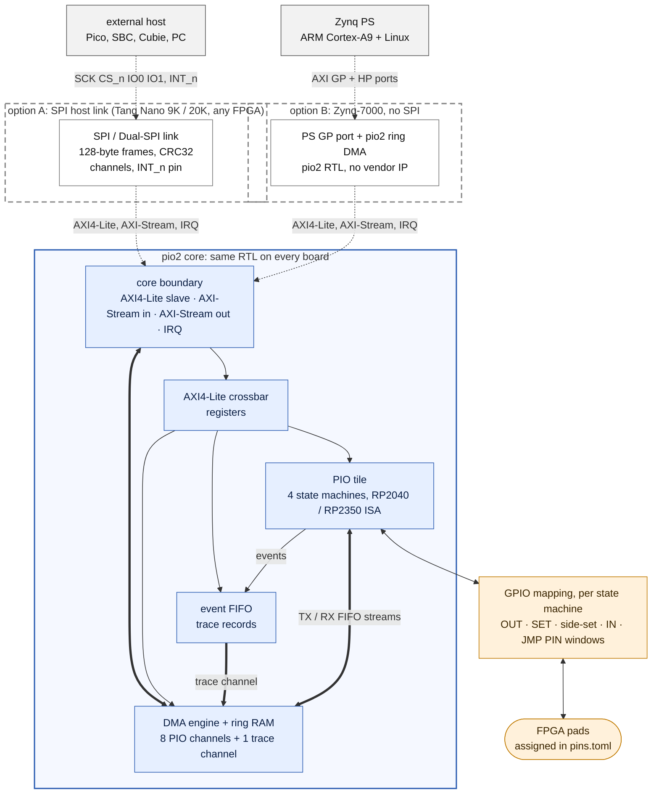
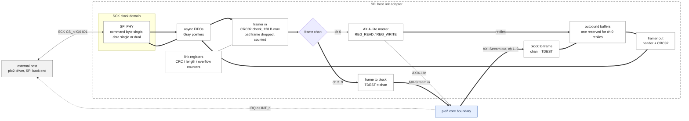
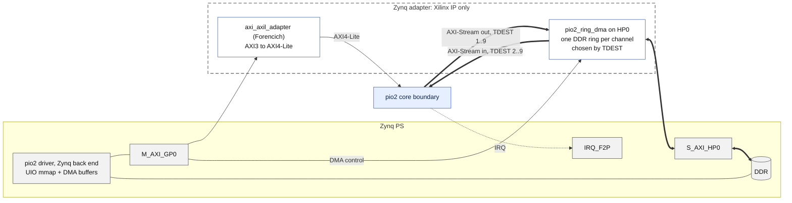
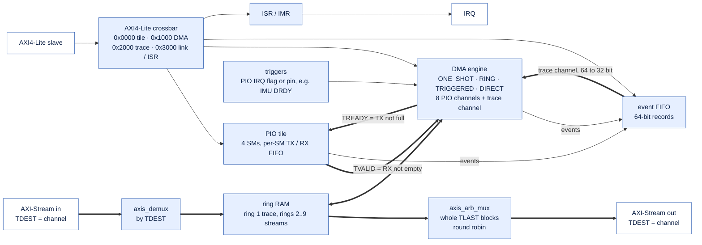
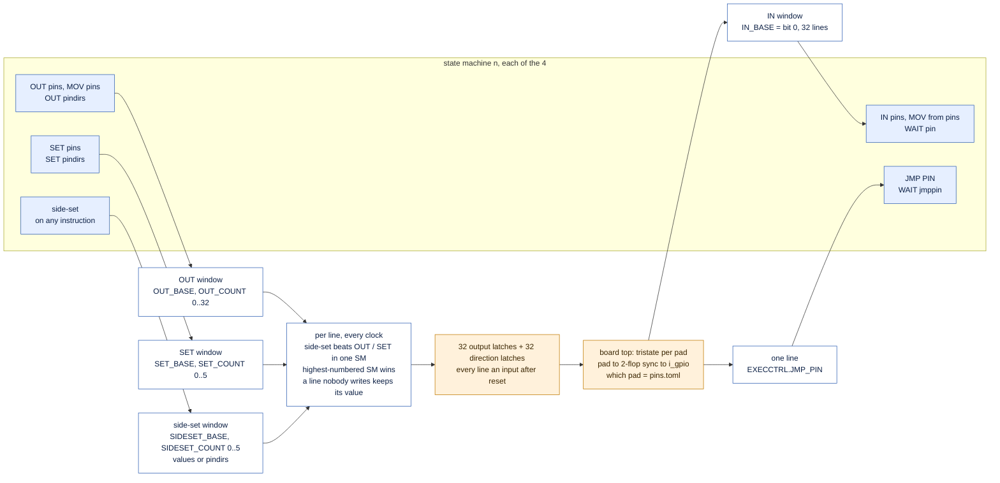
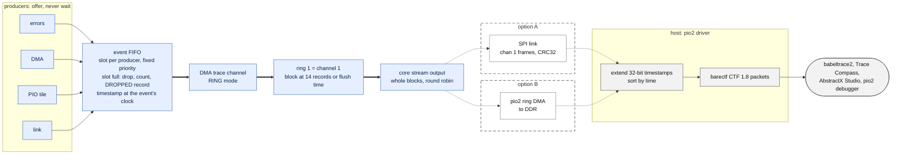

# What pio2 Offers

pio2 is one **core** (PIO tile, DMA engine with rings, event FIFO, AXI4-Lite crossbar) with a fixed
boundary, plus a choice of **host adapter**: an SPI link for an FPGA with an external host (Tang Nano
9K / 20K), or the Zynq's own ARM cores on AXI. The pins are not tied to any protocol: every state
machine maps GPIO windows the way the RP2040 / RP2350 PIO does, and the program decides what the pins
mean (DShot, UART, SPI, WS2812, ...).

Requirements: [`INTERCONNECT_SPECIFICATION.md`](INTERCONNECT_SPECIFICATION.md) (core boundary,
adapters, DMA, trace) and [`SPECIFICATION.md`](SPECIFICATION.md) (the PIO tile). Build state of each
block: [Status](#status) at the end.

**How to read the diagrams**

| Drawn as | Means |
| :--- | :--- |
| dashed box, dotted arrow | optional: a host adapter; a build has one of them |
| thin arrow | AXI4-Lite (registers) |
| thick arrow | AXI-Stream (data, trace) |
| blue box | the pio2 core, the same RTL on every board |
| orange box | pins |

## 1. The system: one core, two optional host adapters

**Which adapter a board builds** (`[SPEC-ICN-11]`): the SPI link is optional.

| Board | SPI link | Zynq adapter | Why |
| :--- | :--- | :--- | :--- |
| Tang Nano 9K / 20K (Gowin, no CPU on chip) | **required** | none | the host is outside the FPGA (Pico, SBC, Cubie) |
| Zynq-7000 | **not built** | **required** | the ARM cores are on the chip, on AXI |
| any other FPGA with an external host | required | none | as the Tang boards |
| simulation (Verilator) | at the pins, or bypassed (`[SPEC-LINK-06]`) | none | same driver either way |

Whatever the host, it sees the same thing: registers on channel 0, data streams on channels 2..9,
the trace on channel 1, one interrupt. The pio2 driver has an SPI back end and a Zynq back end with
the same channel API, and the simulator speaks to the same boundary.

## 2. Option A: the SPI host link

* Each CS_n window starts with a command byte (`WRITE_FRAME` / `READ_FRAME`, bit 7 = dual); the FPGA
  returns the low byte of `ISR` during it, so every window also tells the host what is pending.
* A frame is at most 128 bytes: 12-byte header, up to 116 bytes payload, CRC-32 (the Ethernet CRC).
* The PHY is clocked by SCK itself and crosses to the system clock through async FIFOs, so the FPGA
  clock does not limit the link; goal: at least 10 MB/s payload on Dual SPI (`[SPEC-LINK-01]`).
* Register replies never wait behind stream data: one outbound buffer is theirs (`[SPEC-LINK-08]`).

## 3. Option B: Zynq-7000, straight AXI

| | Option A: SPI link | Option B: Zynq |
| :--- | :--- | :--- |
| Registers | channel 0 frames, the link's AXI4-Lite master | PS GP port, memory mapped (UIO) |
| Streams in / out | `STREAM_DATA` frames, channel in the header | pio2 ring DMA to DDR rings, channel in `TDEST` |
| Integrity | CRC32 per frame | on-chip bus |
| Interrupt | `INT_n` pin | `IRQ_F2P` |
| Throughput | about 10 MB/s goal (Dual SPI) | hundreds of MB/s; the PIO is the limit |
| Host code | same channel API | same channel API |

## 4. Inside the core

* DMA pacing is the AXI-Stream handshake: the same signal as the RP2040's DREQ (`[SPEC-DMA-01]`).
* The trace goes through the DMA like any other stream, into ring 1 (`[SPEC-TRC-02]`), so it reaches
  an SPI host and a Zynq the same way.
* Examples it must carry (`[SPEC-DMA-02]`): DShot frames out on a RING channel; ESC serial both
  ways; IMU auto-DMA, where DRDY triggers a PIO SPI burst and a TRIGGERED channel collects each
  sample block.

## 5. Pin mapping: windows per state machine, not fixed functions

The tile has 32 GPIO lines. No line has a fixed job; each state machine sees the lines through
**windows** set in its `PINCTRL` and `EXECCTRL` registers, as on the RP2040 / RP2350 (datasheet
section "GPIO Mapping": [RP2040 datasheet](https://datasheets.raspberrypi.com/rp2040/rp2040-datasheet.pdf),
[RP2350 datasheet](https://datasheets.raspberrypi.com/rp2350/rp2350-datasheet.pdf)).

Windows wrap modulo 32 (base 30, count 4 covers lines 30, 31, 0, 1). Windows of different state
machines may overlap; that is how one SM can drive a line another reads.

**Examples: the same pins, different programs.** The host sets the bases from the board's pin map
(`[SPEC-PIO-09]`: software asks for `motor3`, never a number), so one program runs on any line.

| Program | OUT | SET | side-set | IN | JMP PIN | Notes |
| :--- | :--- | :--- | :--- | :--- | :--- | :--- |
| Bidirectional DShot (`dshot_bidir.pio`) | motor line | motor line | none | motor line | motor line | drives, then releases the line with `set pindirs, 0` and samples the ESC's reply on the same wire |
| UART TX (pico-examples `uart_tx`) | TX line | none | TX line (opt) | none | none | |
| SPI (pico-examples `spi`) | MOSI | none | SCK | MISO | none | three windows, three different lines |
| WS2812 (pico-examples `ws2812`) | none | none | data line | none | none | everything in side-set |

So "DShot on motor 3" is not a pin function: it is the `dshot_bidir` program on one state machine
with all its windows pointed at the line that the pin map calls `motor3`.

## 6. The trace: from a state machine event to a CTF file

* **barectf is not in the FPGA.** The FPGA makes 8-byte records (`data[15:0]`, `src[23:16]`,
  `type[31:24]`, `timestamp[63:32]`); the host writes the CTF, so simulation and board traces are
  the same files.
* **Losses are visible, never silent**: a producer never waits; if its slot is still full the event is
  dropped and counted, and a `DROPPED n` record (written when the slots are idle, so it never causes
  more losses) marks the gap by its timestamp.

## Status

State on 2026-10-29 (details: [`../TODO.md`](../TODO.md)).

| Block | State |
| :--- | :--- |
| PIO tile, AXI4-Lite register port, pin mapping | built; 43 cocotb tests, formal BMC on the AXI4-Lite port |
| Event FIFO | built; 5 cocotb tests, two mutants caught |
| Crossbar, DMA engine and rings, stream mux / demux, `ISR` / `IMR` | specified |
| Tile FIFO stream ports | specified (`[SPEC-ICN-09]`); today the FIFOs are reached through TXFx / RXFx |
| SPI host link | specified |
| Zynq adapter | specified |
| Host driver, CTF conversion | specified |
